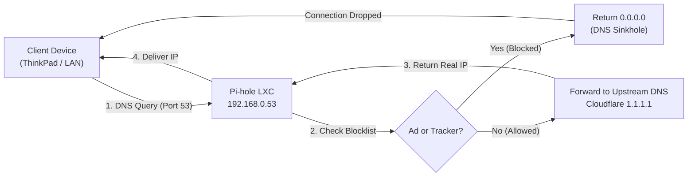

# Deploying Network-Wide DNS Filtering with Pi-hole on Proxmox

## Scenario
Modern web traffic generates constant background requests to advertising networks and telemetry trackers, wasting bandwidth and increasing exposure to malicious ad redirects. The goal of this lab deployment was to stand up a lightweight, self-hosted DNS sinkhole (Pi-hole) inside a Proxmox Linux container, verify that known tracking domains are blocked at the DNS layer, and measure real query reduction over a 24-hour period.

## Environment
- **Hypervisor:** Proxmox VE (bare-metal home lab on HP ProDesk 600 G1, x86_64 Intel CPU, 8 GB RAM)
- **Container:** Unprivileged Debian 12 (`amd64`) LXC — CT 101 (`pihole`), 1 vCPU, 512 MiB RAM, 8 GiB disk
- **Network:** Static IP `192.168.0.53/24`, Gateway `192.168.0.1` (CenturyLink router), Upstream DNS `1.1.1.1` (Cloudflare)
- **Test Client:** ThinkPad T490 running Arch Linux (KDE Plasma)
- **Access Level:** Proxmox `root` and Pi-hole admin in an isolated personal home lab

## Investigation

### What Pi-hole Does (Architecture)
Pi-hole acts as a **local DNS sinkhole** between client devices and the public internet. Instead of installing browser extensions on every device, clients send their DNS lookups (port 53) to Pi-hole first. Pi-hole checks each requested domain against curated blocklists: legitimate domains are forwarded to an upstream resolver (Cloudflare `1.1.1.1`), while ad and tracking domains receive `0.0.0.0`, dropping the request before any content downloads.

### Installation & Verification Process
1. **Resource Planning:** Chose a Debian LXC container instead of a full VM because Linux containers share the host kernel and avoid the heavy disk I/O overhead I experienced with Windows Server on a spinning SATA drive.
2. **Container Provisioning:** Downloaded the `debian-12-standard` (`amd64`) CT template in Proxmox and created CT 101 (`pihole`) with 1 vCPU, 512 MiB RAM, 8 GiB storage on `local-lvm`, and static IP `192.168.0.53/24`.
   ![Proxmox LXC configuration]
3. **Pi-hole Installation:** Logged into the CT 101 console, installed `curl`, and ran the official installer (`curl -sSL https://install.pi-hole.net | bash`). Selected Cloudflare (`1.1.1.1`) as the upstream DNS provider, enabled StevenBlack's Unified Hosts blocklist, and enabled query logging.
4. **CLI Verification:** Queried Pi-hole directly from my Arch Linux laptop using `nslookup` to confirm legitimate domains resolved normally while `doubleclick.net` returned `0.0.0.0`.
   ![DNS sinkhole CLI test]
5. **Client Cutover & Query Log Check:** Configured my ThinkPad's IPv4 network profile in KDE Plasma to use `192.168.0.53` as its sole DNS server, browsed several sites, and verified live `Blocked (gravity)` entries in the Pi-hole Query Log.
   ![Pi-hole Query Log]

